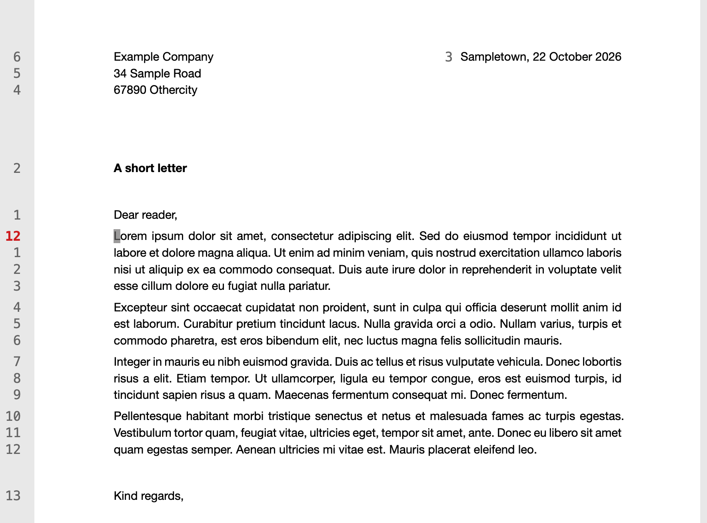
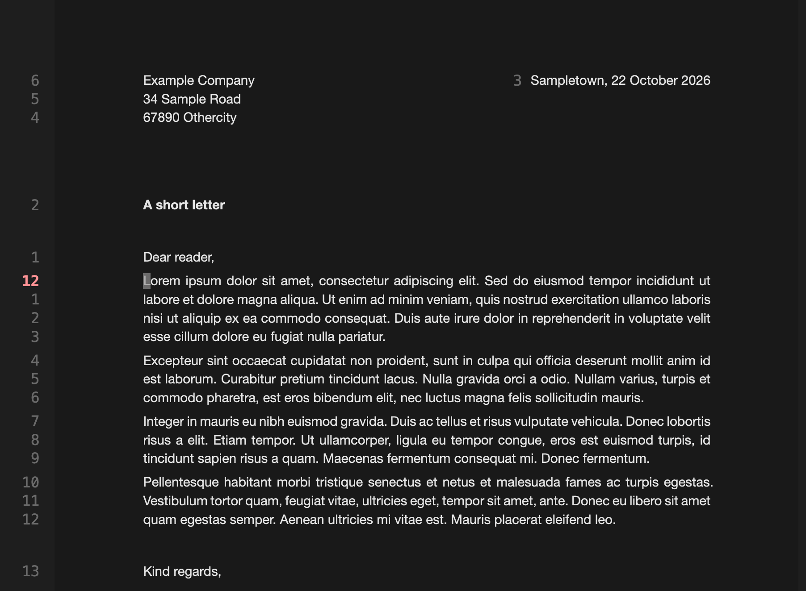
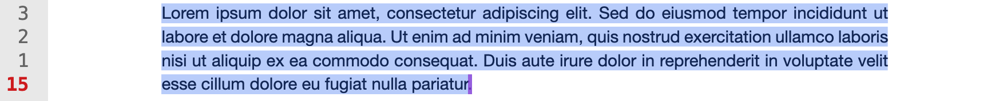

# ggPdf

Heavily vibecoded minimal keyboard-driven PDF viewer with Vim-style motions and
text selection, based on PDFium engine.

<p align="center">
  
</p>

| Cursormode                                                  | Darkmode                                                  |
| ----------------------------------------------------------- | --------------------------------------------------------- |
|  |  |

| Sentence selection in vim-like visual mode                          | Paragraph selection with vip                                         |
| ------------------------------------------------------------------- | -------------------------------------------------------------------- |
|  |  |

## Install & use

### Prebuilt installers

Download an installer from the
[releases page](https://github.com/JensOlschewski/ggpdf/releases). Installers
include PDFium; Rust/Cargo is only needed to build from source.

### Build from source

Requires Rust/Cargo and PDFium for your OS and architecture. Place PDFium at
`pdfium/libpdfium.dylib` (macOS) or `pdfium/pdfium.dll` (Windows).

```sh
git clone https://github.com/JensOlschewski/ggpdf
cd ggpdf
```

Build and install (rerun to update):

- **macOS:** `./install-macos.sh` installs to `/Applications/ggPdf.app`.
- **Windows (PowerShell):** `.\install-windows.ps1` installs to
  `%LOCALAPPDATA%\Programs\ggPdf` and adds Start menu and **Open with** entries.

If PowerShell blocks the script, use
`powershell -ExecutionPolicy Bypass -File .\install-windows.ps1`. Neither script
changes your default PDF viewer.

Or run without installing:

```sh
cargo run -- assets/test-pdfs/letter.pdf
```

### Open PDFs

Use **Open with → ggPdf**, drag a PDF into the window, or press **Ctrl+O**. On
macOS, you can also run `open -a ggPdf /path/to/document.pdf`.

## Keys

| Keys                | Action                       |
| ------------------- | ---------------------------- |
| `gg` / `G`          | Go to top / bottom           |
| `j` / `k`           | Scroll down / up 50 px       |
| `Ctrl+d` / `Ctrl+u` | Scroll down / up 150 px      |
| `Ctrl+k` / `Ctrl+j` | Zoom in / out                |
| `Ctrl+0`            | Reset zoom to 100%           |
| `i`                 | Toggle dark/light mode       |
| `q`                 | Close ggPdf                  |
| `c`                 | Enter/Leave text cursor mode |
| `v` / `Shift+v`     | `VISUAL` / `VISUAL LINE`     |

### Text cursor and selection

| Keys            | Action                                              |
| --------------- | --------------------------------------------------- |
| `h` / `l`       | Move left / right one character                     |
| `j` / `k`       | Move down / up one text line                        |
| `w` / `b` / `e` | Next word / previous word / word end                |
| `W` / `B` / `E` | WORD motions (punctuation stays in a word)          |
| `0` / `^` / `$` | Go to line start / first nonblank / end             |
| `Esc`           | Clear selection, or exit from `CURSOR`              |
| `y`             | Copy selection and exit (linewise includes newline) |
| `is` / `ip`     | Select sentence / paragraph in `VISUAL`             |
| `yis` / `yip`   | Copy sentence / paragraph in `CURSOR`, exit         |

Prefix `h/j/k/l` and word motions with a count (e.g. `3j`, `2w`, `4l`).

## Appearance

Edit `~/.config/ggpdf/config.toml` to adjust the canvas colors and page gap:

```toml
[appearance]
canvas_light = "#ededed"
canvas_dark = "#282828"
page_gap = 12
```

The native app renders its own UI; the old `theme.css` and `style.css` no longer
apply.

## Local PDFs

Website PDF links retain Chrome's normal handling. This app opens local PDFs
without a Python server or browser profile.

## License

ggPdf's own code is MIT-licensed (see `LICENSE`). PDFium's license is in
`pdfium/LICENSE.txt`.
