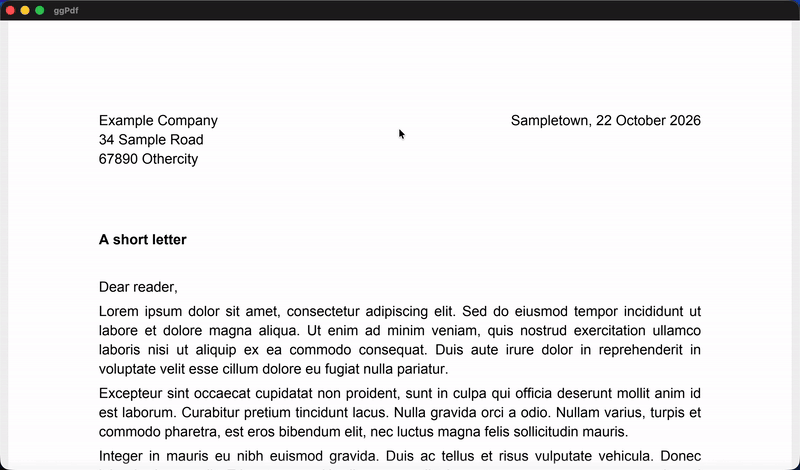
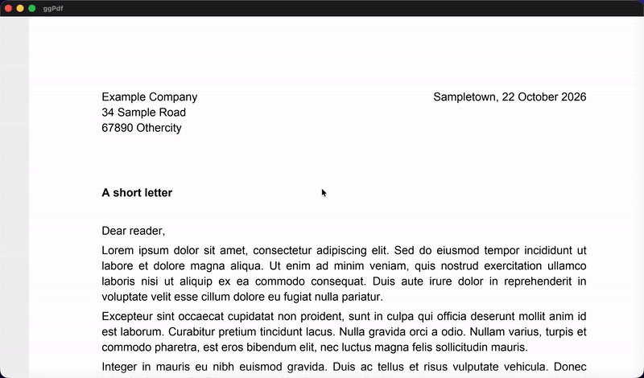

# ggPdf

<p align="center">

</p>

Minimal and light keyboard-driven PDF viewer with Vim-style motions and text
selection, based on PDFium engine.

| Selection with ggPdf                                       | Document handling with ggPdf                              |
| ---------------------------------------------------------- | --------------------------------------------------------- |
|  |  |

## Install & use

### Prebuilt installers

Download an installer from the
[releases page](https://github.com/JensOlschewski/ggpdf/releases)

### Build from source

Requires Rust/Cargo and PDFium for your OS and architecture. Place PDFium at
`pdfium/libpdfium.dylib` (macOS) or `pdfium/pdfium.dll` (Windows).

```sh
git clone https://github.com/JensOlschewski/ggpdf
cd ggpdf
```

Build and install (rerun to update):

- **macOS:** `./install.sh` installs to `/Applications/ggPdf.app`.
- **Windows (PowerShell):** `.\install.ps1` installs to
  `%LOCALAPPDATA%\Programs\ggPdf` and adds Start menu and **Open with** entries.

If PowerShell blocks the script, use
`powershell -ExecutionPolicy Bypass -File .\install.ps1`. Neither script changes
your default PDF viewer.

Or run without installing:

```sh
cargo run -- assets/test-pdfs/letter.pdf
```

## ⌨️ Mappings

### Document mode

| Keys                | Action                       |
| ------------------- | ---------------------------- |
| `gg` / `G`          | Go to top / bottom           |
| `j` / `k`           | Scroll down / up 50 px       |
| `Ctrl+d` / `Ctrl+u` | Scroll down / up 150 px      |
| `Ctrl+k` / `Ctrl+j` | Zoom in / out                |
| `Ctrl+0`            | Reset zoom to 100%           |
| `i`                 | Toggle dark/light mode       |
| `q`                 | Close ggPdf                  |
| `c`                 | Enter/Leave text cursor mode |
| `v` / `Shift+v`     | `VISUAL` / `VISUAL LINE`     |
| `yis` / `yip`       | Copy sentence / paragraph    |
| `ctr+f`             | fzf pdf search               |
| `ctr+shift+f`       | Native file dialog           |

### Cursor and visual mode

| Keys            | Action                                              |
| --------------- | --------------------------------------------------- |
| `h` / `l`       | Move left / right one character                     |
| `j` / `k`       | Move down / up one text line                        |
| `w` / `b` / `e` | Next word / previous word / word end                |
| `W` / `B` / `E` | WORD motions (punctuation stays in a word)          |
| `0` / `^` / `$` | Go to line start / first nonblank / end             |
| `Esc`           | Clear selection, or exit from `CURSOR`              |
| `y`             | Copy selection and exit (linewise includes newline) |
| `is` / `ip`     | Select sentence / paragraph in `VISUAL`             |

Outside text modes, `yis` / `yip` copy the sentence / paragraph under the mouse,
or at the center of the window if the mouse is not over a page.

Prefix `h/j/k/l` and word motions with a count (e.g. `3j`, `2w`, `4l`).

Mappings can be be fully defined in the config file. See
[`config.example.toml`](config.example.toml).

| Table              | Applies to                                           |
| ------------------ | ---------------------------------------------------- |
| `[keys.document]`  | Normal mode (scrolling, file-level keys)             |
| `[keys.motion]`    | Shared by cursor and selection modes                 |
| `[keys.cursor]`    | Cursor mode: `motion` plus this table                |
| `[keys.selection]` | `VISUAL` and `VISUAL LINE`: `motion` plus this table |

## ⚙️ Configuration

ggPdf reads the first existing file of:

1. `$XDG_CONFIG_HOME/ggpdf/config.toml` (or `~/.config/ggpdf/config.toml`)
2. macOS: `~/Library/Application Support/ggpdf/config.toml`
3. Windows: `%APPDATA%\ggpdf\config.toml`

- [`config.example.toml`](config.example.toml) lists every option and key
  binding with its default.

Copy it and edit.

- An invalid file is reported on stderr and the defaults are used.
- Undefined options keep their defaults.
- `ggpdf --print-config` prints the resolved config, a good starting point for
  your own file.

### Appearance

- `[appearance]` holds colors (`#rrggbb` or `#rrggbbaa`), sizes, and fonts.
- Colors come as `_light` / `_dark` pairs.
- `font_file` points to a `.ttf`/`.otf` file used before the built-in font;
  empty means built-in.

## License

ggPdf's own code is MIT-licensed (see `LICENSE`). PDFium's license is in
`pdfium/LICENSE.txt`.
